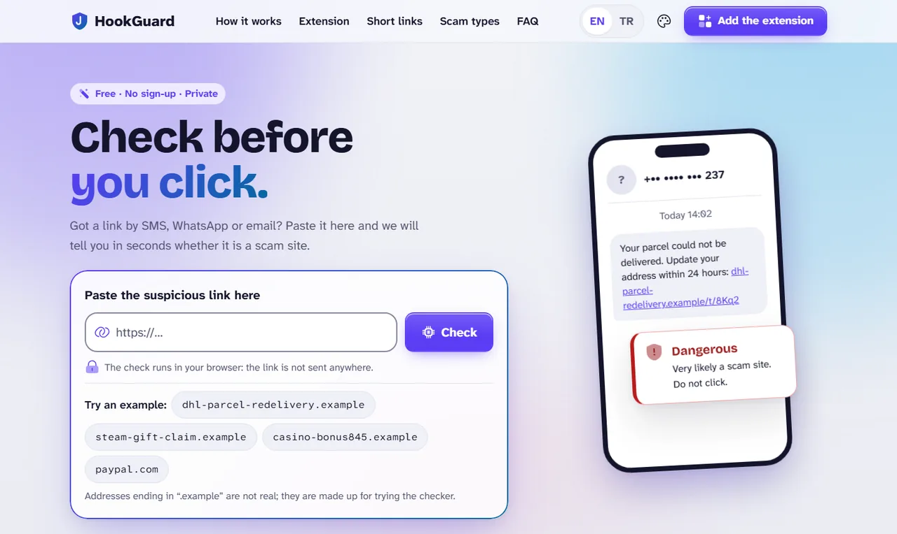
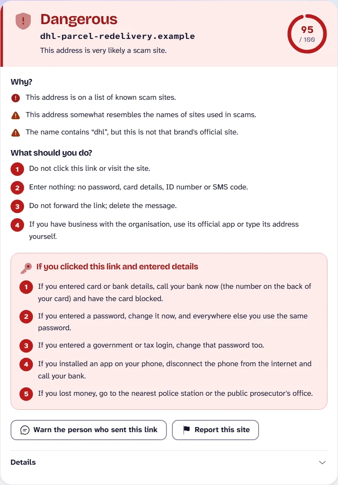
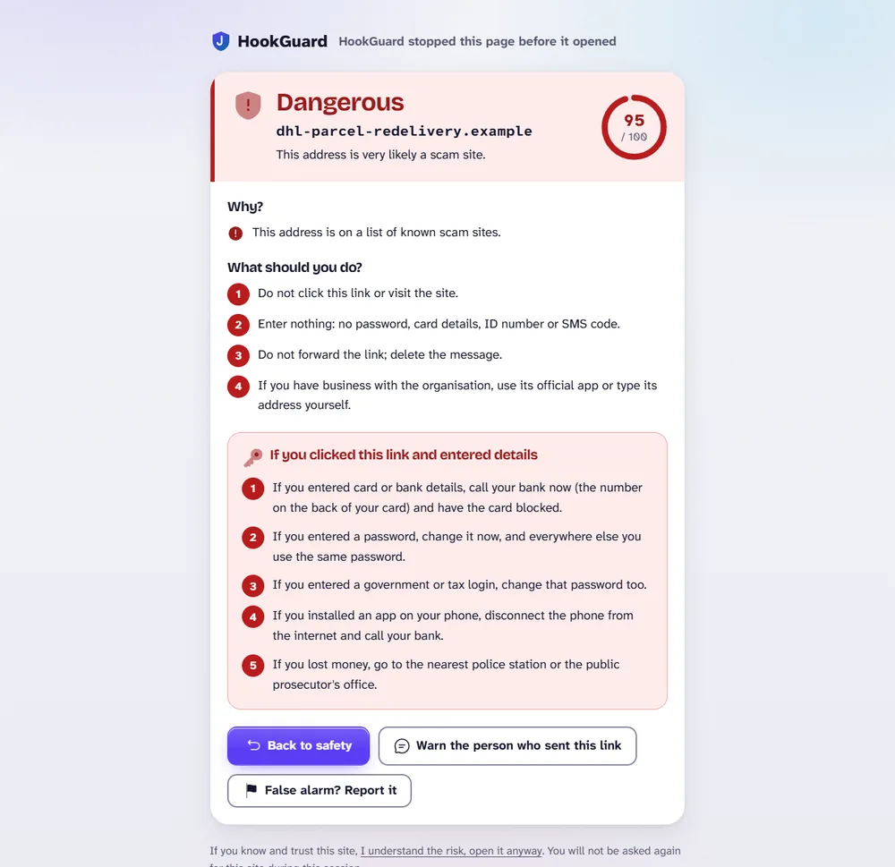
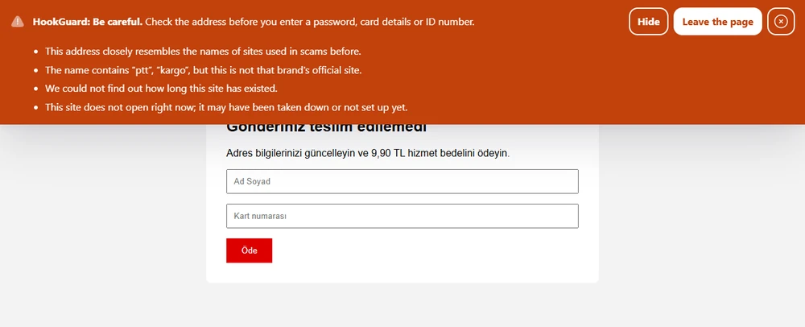
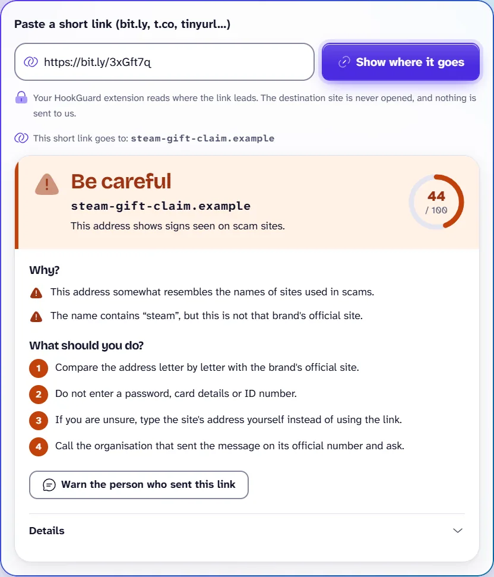
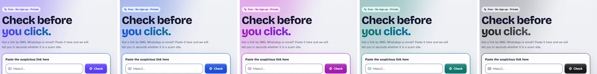

<p align="center">
  <picture>
    <source media="(prefers-color-scheme: dark)" srcset="docs/images/hero-dark.webp">
    
  </picture>
</p>

<h1 align="center">HookGuard</h1>

<p align="center">
  <strong>Check before you click.</strong><br>
  A phishing link checker and browser extension for people who are not technical, built around the scams that reach phones in Turkey.
</p>

<p align="center">
  <a href="https://github.com/DuranOzcelik/hookguard/actions/workflows/ci.yml"></a>
  
  
</p>

---

A text message says your parcel is stuck, your bank account is suspended or you have won a prize, and it has a link. HookGuard tells you what that link really is before you open it: **Looks safe**, **Be careful** or **Dangerous**, why, and what to do next. If you already clicked, it tells you what to do now.

<p align="center"><b>Try it: <a href="https://duranozcelik.github.io/hookguard/">duranozcelik.github.io/hookguard</a></b></p>

It comes in three parts:

- **A web page** where anyone can paste a link and get an answer in seconds. The check runs in the browser, so the link is not sent anywhere.
- **A browser extension** for Chrome, Edge and Firefox that stops dangerous sites before they open. It checks on your device too.
- **An optional API** you can run yourself. It adds how long a site has existed and a safe link shortener.

## Try it

Paste any of these into the [web page](https://duranozcelik.github.io/hookguard/). They are made up: names ending in `.example` are reserved and can never be real sites, so they are safe to try anywhere.

| Address | HookGuard says | Why |
| --- | --- | --- |
| `dhl-parcel-redelivery.example` | **Dangerous** | It is on the known-threat list. This address and `paypal-account-verify.example` are there on purpose, for testing, the way antivirus makers keep a harmless test file. |
| `casino-bonus845.example` | **Dangerous**: illegal betting | A gambling word and a number at the end, as betting sites use when an old address is blocked |
| `steam-gift-claim.example` | **Be careful** | A brand's name on a site that is not the brand's, and a name like those of scam sites |
| `crypto-profit-daily.example` | **Be careful**: possible fake investment | Investment and profit words in the name |
| `paypal.com` | **Looks safe** | PayPal's official site |

With the extension installed, open these links and it stops them before they load:

- [http://dhl-parcel-redelivery.example](http://dhl-parcel-redelivery.example/) shows the red warning page.
- [http://casino-bonus845.example](http://casino-bonus845.example/) shows the illegal betting page, with a helpline.

Without the extension your browser just says the site cannot be reached.

## What it looks like

<table>
  <tr>
    <td width="50%"></td>
    <td width="50%"></td>
  </tr>
  <tr>
    <td><b>The answer.</b> A clear title, the reasons in plain words, what to do, and a button to warn the person who sent the link.</td>
    <td><b>The extension.</b> A dangerous site is stopped before it loads. Known scams never reach the page.</td>
  </tr>
  <tr>
    <td></td>
    <td></td>
  </tr>
  <tr>
    <td><b>Be careful.</b> On suspicious pages an orange strip explains why, in a Shadow DOM the page cannot hide.</td>
    <td><b>Short links.</b> See where a bit.ly link really goes. With your own API, also make short links that show a safety check first.</td>
  </tr>
</table>

<p align="center">
  <br>
  <sub>Five colour palettes, light and dark themes, English and Turkish.</sub>
</p>

## Features

**Web page**
- Paste a link (even a "defanged" one like `hxxps://site[.]com`) and get a verdict with reasons, steps to take, and steps for after a click.
- Warn the sender on WhatsApp with one tap; only the domain goes into the message.
- Report a suspicious site, or a false alarm. The report form fills in a GitHub issue; with your own API, reports go to a private review queue instead.
- **Short links:** with the extension installed, see where a bit.ly, t.co or tinyurl link leads without visiting it. With your own API the page does this by itself, and also shortens links safely: dangerous destinations are refused, and whoever opens a HookGuard short link first sees where it goes and a fresh check.
- English or Turkish; five colour palettes (Aurora, Ocean, Orchid, Lagoon, Graphite); light, dark or system theme.
- Large type, high contrast (WCAG AA in every palette and theme), keyboard friendly, honours reduced motion.

**Browser extension**

| | |
| --- | --- |
| Known scams | Stopped before the page loads, using a local hash list. |
| Suspicious sites | Checked on your device with the same scoring as the API, without its lookups. Dangerous ones get a warning page, doubtful ones an orange strip. Redirect chains are followed hop by hop. |
| Form protection | Warns the moment you start typing a password, a card number or a Turkish ID number into a risky or brand-new site. What you type is examined on your device and never sent. |
| Download warning | Pauses `.apk` files from anything but well-known sites, and `.exe` and similar files from risky sites, until you decide. This guards against fake bank and parcel apps. |
| Short link preview | Hover a short link to see where it leads and how that site looks. The destination is never contacted. |
| Link badges | Green, orange or red badges next to links in Gmail, Outlook and WhatsApp Web. |
| Page signals | Recognises illegal betting pages (with Yeşilay's helpline 115), fake investment promises, shops without an ETBİS registration and fake "virus found" screens. |
| Family mode | Locks betting and adult sites behind a PIN. |
| Weekly summary | A short notification each week, counted on your device. |

Every protection except the known-scam block can be switched off in the extension's settings.

## How it decides

A domain gets a score from 0 to 100. Below 40 it reads "Looks safe", 40 to 69 "Be careful", and 70 or more "Dangerous".

| Signal | Effect | In the browser |
| --- | --- | --- |
| On the known-threat list (USOM, Turkey's national CERT, plus reviewed user reports), or its parent domain is | at least 95 or 90 | yes |
| It resolves to an IP address on that list | at least 85 | API only |
| A machine-learning model of the name: character patterns of 4,400 phishing domains against 30,000 ordinary ones | up to 60 | yes |
| A brand's name in a domain that is not the brand's; lure words of giveaway and campaign scams | +10; +5 | yes |
| How long the domain has existed (RDAP, or WHOIS for `.tr`) | +20 if under a week old; −10 if over two years | API only |
| A subdomain of a free hosting or dynamic DNS service; a bare IP address | +5; +25 | yes |
| An official brand domain; one of the world's most visited sites | capped low | yes (top 10,000; the API knows the top 100,000) |

Next to the score, a category is guessed from the name and, in the extension, from the page: illegal betting, fake investment, fake shop, adult or fake tech support. A category can raise the verdict people see (an illegal betting site is never shown as safe) but never changes the score.

The web page and the extension compute the score in the browser (`shared/engine/`), from data the Pages build exports: the model's weights, the hash lists and the word lists. A test compares the result with the Python scoring on several hundred names, reason by reason. A browser cannot look up DNS or registration dates; your own API adds them.

At the threshold it uses for alarms, the model catches about half of new phishing domains from their name alone, at a false-positive rate of 0.1%. The other signals do the rest. No tool can promise 100%; the page says so too.

## Privacy

- The web page checks links **in your browser**. Nothing you paste is sent anywhere; the page only downloads its data files from GitHub Pages.
- The extension checks the sites you open **on your device**, and downloads updated lists from the same place every six hours. The sites you visit are not sent anywhere.
- Form protection, page signals and the weekly counts stay on the device.
- To show where a short link leads, the extension asks the shortener (bit.ly, t.co, ...) for its redirect and never contacts the destination. The web page asks the extension, if it is installed.
- Reports are GitHub issues, which are public; the form says so before it opens one.
- With your own API, only the **domain** is sent, never the full link: from `dhl-parcel-redelivery.example/track?no=123` the API receives `dhl-parcel-redelivery.example`. It keeps queried domains in memory only. Its safe shortener stores the full link, because that is what a short link is.

## Getting started

### Use it

- **Web page:** [duranozcelik.github.io/hookguard](https://duranozcelik.github.io/hookguard/)
- **Extension:** download the zip for your browser from [Releases](https://github.com/DuranOzcelik/hookguard/releases/latest) and unzip it.
  - **Chrome or Edge:** open `chrome://extensions` (or `edge://extensions`), turn on *Developer mode*, choose *Load unpacked* and pick the folder.
  - **Firefox 140+:** open `about:debugging`, choose *This Firefox* > *Load Temporary Add-on* and pick `manifest.json`. Firefox removes it when it closes, until the extension is in its add-on store.

### Build it yourself

You need **Python 3.12+** and **Node.js 24+**. Run everything from the repository root.

```bash
python -m venv .venv
# Windows: .venv\Scripts\activate    macOS/Linux: source .venv/bin/activate
pip install -r requirements.txt

# Optional: the Tranco list of popular sites, for the "well-known site" signal and the allowlist
mkdir -p external/tranco
curl -L -o external/tranco/top-1m.csv.zip https://tranco-list.eu/top-1m.csv.zip

python -m tools.train_model     # the name model (about a minute) -> external/stage1.joblib
python -m tools.build_static    # the data for checks in the browser -> web/public/data, extension/public/data

npm install
npm run dev -w web              # the web page on http://localhost:5173
npm run build -w extension      # Chrome -> extension/.output/chrome-mv3 (also build:edge, build:firefox, zip)
```

`npm run build -w web` builds the page into `web/dist`. Set `VITE_BASE` when it is served under a path, as on GitHub Pages (`VITE_BASE=/hookguard/`). Any static host will do; the build has its own copy of the `/short-links` page.

The [Pages workflow](.github/workflows/pages.yml) does all of this on every push to `main` and publishes the page. Extensions download their data from it.

### Your own API (optional)

```bash
uvicorn backend.app:app --port 8000 --no-access-log
npm run dev:api -w web          # the web page with the API: /api is proxied to port 8000
```

In the extension's settings, enter the API's address under *Your own HookGuard server*; empty means checks on the device. To build them for an API instead: `VITE_API_BASE=https://your-api.example npm run build -w web` and `WXT_API_BASE=https://your-api.example npm run build -w extension`.

## Keeping it up to date

```bash
python -m tools.update_usom --once     # fetch new entries from USOM into data/usom_seen.csv
git commit -am "Update the threat list" && git push    # the Pages workflow retrains, rebuilds and publishes
```

Extensions pick up the new lists within six hours, or at once with *Update the list now* in their settings.

Reports arrive as [GitHub issues](.github/ISSUE_TEMPLATE/report.yml). After reviewing one:

```bash
python -m backend.reports add DOMAIN --category gambling    # -> data/community_blocklist.csv; then commit and push
```

With your own API, the reports its users send wait in a private queue: `python -m backend.reports list`, `approve DOMAIN` or `reject DOMAIN`.

Nothing reaches other users unreviewed, so nobody can get a competitor blocked by reporting it.

## API

Optional: the web page and the extension work without it.

| Endpoint | |
| --- | --- |
| `POST /api/check` | `{"domain": "...", "lang": "en"}` returns `score`, `level`, `reasons`, `category` and `details` |
| `POST /api/expand` | `{"url": "https://bit.ly/..."}` returns the host a short link leads to (known shorteners only) |
| `POST /api/shorten` | `{"url": "..."}` returns a short link, unless the destination is dangerous |
| `GET /api/short/{code}` | Where a HookGuard short link leads, checked again now |
| `POST /api/report` | `{"domain", "category", "note"}`: a report for review |
| `GET /api/blocklist` | SHA-256 prefixes of known-threat names, for the extension (`ETag`-cached) |
| `GET /api/allowlist` | The same for official and very popular sites |
| `GET /api/health` | What is loaded |

Each client address may make 60 requests a minute. Interactive documentation is at `/docs` while the API runs.

## Project layout

```
backend/          the optional API (FastAPI): scoring, categories, lookups, reports, short links
tools/            update_usom.py (refresh the threat list), train_model.py (train the name model),
                  build_static.py (export the data for checks in the browser)
data/             usom_seen.csv (known threats), ct_random.csv (ordinary domains), tr_brands.csv (official brand domains)
shared/           shared by the web page and the extension: engine/ (the score in the browser),
                  texts in both languages, design tokens, React components
web/              the web page (React, Vite, TypeScript)
extension/        the browser extension (WXT, React; Manifest V3)
design-system/    the design system (MASTER.md)
tests/            API tests (pytest)
```

## Development

```bash
python -m pytest           # API: no network, data or model needed
npm test -w web            # shared helpers; with the data built, also the browser score against Python
```

The comparison needs cases scored in Python: `python -m tools.build_static --parity build/parity.json`, then `npm test -w web`.

The visual design follows `design-system/MASTER.md`. Components use only the tokens in `shared/design/`; palettes are in `palettes.css`. All user-facing text lives in `shared/content.ts` and in `TEXT = { en, tr }` dictionaries next to the components. It never names sources or techniques: people read "a list of known scam sites", not the name of a feed or a model.

## Limitations

- The name model learned from phishing aimed at Turkey. Lookalike names in other languages usually get "Be careful" rather than "Dangerous" until they are on the list.
- In the browser there is no DNS and no registration date, so a brand-new scam site with an innocent-looking name can pass as "Looks safe" until it is on the list. Your own API adds those signals.
- The lists are as fresh as the last push: the threat list is updated by hand with `tools/update_usom.py`.
- The betting, investment and shop categories are rules, not trained models; there is no labelled data for them yet. The list of licensed Turkish betting sites (`LEGAL_BETTING` in `backend/categories.py`) must be kept current.
- A web page alone cannot see where a short link leads; it needs the extension or your own API.
- With your own API, the first check of a new domain takes a second or two (WHOIS), so a page it rates dangerous may start loading before the warning replaces it. Known scams are always stopped first.
- Link badges rely on how Gmail, Outlook and WhatsApp Web build their pages, which can change.

## Background

HookGuard started as research on phishing in Turkey. Across 4,076 domains on USOM's list, 26% had a fresh TLS certificate, and for 98% of those the certificate appeared before the listing, a median of 19 hours earlier. That gap is what an early-warning tool can use. The research tooling (certificate-log listeners, crawlers) is not part of this repository; what is here is what people need to stay safe.

## Credits

Icons: [Solar](https://icon-sets.iconify.design/solar/) by 480 Design (CC BY 4.0). Fonts: Atkinson Hyperlegible by the Braille Institute and Bricolage Grotesque by Mathieu Triay (SIL OFL). Details are in [THIRD_PARTY_NOTICES.md](THIRD_PARTY_NOTICES.md).

Known threats come from [USOM](https://siberguvenlik.gov.tr/zararli-baglantilar), and popular sites from the [Tranco](https://tranco-list.eu) list.

HookGuard helps; it is not a guarantee. When in doubt, do not enter your details: call the organisation on its official number.
